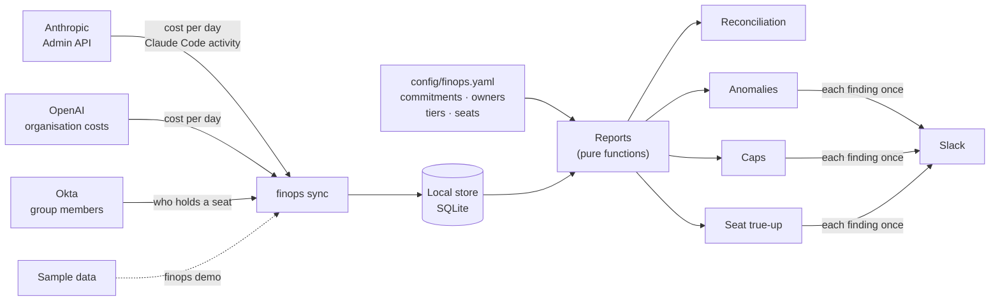

# ai-spend-finops

**AI spend and seat FinOps:** what the company was billed for AI, measured against what
it committed, what each team was given, and who actually uses the seats it pays for.

> **Status:** complete and tested. **No vendor or identity provider has been called for
> real yet:** the adapters follow their documentation and are tested against stand-ins,
> and the demo runs on sample data. "What's real vs. mocked" below says which is which.

## The problem

AI spend arrives in pieces. Per-token API usage is billed by each vendor, per workspace
or project. Seats are assigned through the identity provider and billed per head. A
commitment was signed with each vendor months ago. Nobody sees the whole picture, so
every month the same questions get answered by hand, by whoever wrote the spreadsheet:

- **Are we using what we committed,** paying for nothing, or heading for overage?
- **Which team spent it,** and is anyone past what they were given?
- **Did something go wrong yesterday,** like a batch job in a loop?
- **Who holds a paid seat they never use,** and what would reclaiming those save?
- **Whose is this project** that nobody remembers creating?

This tool answers them the same way every time, from a config file anyone can review,
with a runbook anyone can follow.

## What it produces

On the bundled sample data (`make demo`; every figure is invented):

**Reconciliation against commitments**

| Vendor | Committed | Billed so far | Projected | Of commitment |  |
|---|---|---|---|---|---|
| anthropic | $6,000 | $4,551 | $4,551 | 76% | $1,449 of the commitment unused |
| openai | $3,000 | $3,441 | $3,441 | 115% | $441 over the commitment |

**Spend nobody has claimed**

| Vendor / scope | Billed |
|---|---|
| anthropic/default | $215 |
| openai/proj_sandbox | $148 |

**Spend against caps**

| Team | Tier | Spent | Soft cap | Hard cap | Of hard cap | Status |
|---|---|---|---|---|---|---|
| compliance | small | $552 | $500 | $600 | 92% | over soft cap |
| research | small | $484 | $500 | $600 | 81% | ok |
| eng-backend | standard | $3,784 | $3,500 | $5,000 | 76% | over soft cap |
| trading-desk | standard | $2,809 | $3,500 | $5,000 | 56% | ok |

**Anomalies** (a team's day against its own last two weeks)

| Vendor | Team | That day | A typical day | Multiple |
|---|---|---|---|---|
| openai | research | $194 | $11 | 17.4x |

**Seat true-up**

- **Seats held:** 40 at $30 a month
- **Too new to judge:** 0
- **Unused for 45 days or more:** 9
- **Saving if reclaimed:** $270 a month, $3,240 a year

Anomalies, cap crossings and the seat summary also go to Slack, each once.

## Architecture



Sync copies what the sources say into a local store. Reports are pure functions of that
store and the config: no network and no clock inside them, so they are testable and can
be re-run for any past day.

## Quickstart

```bash
git clone https://github.com/AndrewTtofi/ai-spend-finops.git && cd ai-spend-finops
docker compose up            # the demo: sample data, all four reports, no credentials
```

Without Docker:

```bash
python3.12 -m venv .venv && . .venv/bin/activate
make install
finops demo
```

With real sources (see [the runbook](docs/runbook.md)):

```bash
cp .env.example .env                 # admin keys; a source without one is skipped
$EDITOR config/finops.yaml           # commitments, owners, tiers, seat plans
finops check-config
finops sync --days 75
finops report reconcile --month 2026-09
finops report caps --notify
finops report anomalies --notify
finops report seats --format json
```

## What's real vs. mocked

| Part | Status |
|------|--------|
| The four reports and their arithmetic | **Real**, tested on hand-made inputs where the right answer is obvious |
| The local store, idempotent sync, alert-once | **Real**, tested |
| Config validation | **Real**, in CI |
| `finops demo` and `docker compose up` | **Real code on sample data.** The data is generated with a fixed seed and built to contain one of each finding. Every figure is invented |
| Anthropic adapter (cost report, Claude Code analytics) | **Written from Anthropic's documentation, tested against a stand-in.** Never run with a real admin key |
| OpenAI adapter (organisation costs) | **Written from memory of OpenAI's API, tested against a stand-in.** Its documentation could not be fetched while building this, so this is the adapter most likely to need correcting |
| Okta adapter (group members) | **Written from Okta's documented API, tested against a stand-in.** Never run against a tenant |
| Slack alerts | **Real** webhook call, tested against a stand-in |
| The scheduled workflow | **Written, not exercised** with secrets |

Known limits:

- **It reports; it doesn't block.** Enforcing a cap at request time is a gateway's job
  ([ai-gateway](https://github.com/AndrewTtofi/ai-gateway) does that).
- **Cost is attributed per vendor workspace or project.** Two teams sharing one can't be
  told apart here.
- **Projections are linear** from the month's pace so far.
- **Seat activity** covers only products whose use a vendor reports per person.

## Design decisions and trade-offs

**Sync into a local store, then report from it.** Reports are reproducible, a past month
can be re-run, and one vendor being down doesn't stop the others. *Trade-off:* the data
is as fresh as the last sync.

**Reports are pure functions.** Records and config in, a report out. *Trade-off:* a
little more plumbing in the command-line layer, which is where the clock and the
database live.

**Decisions live in one reviewed YAML file.** Commitments, owners, caps and seat prices
change by pull request, validated in CI. *Trade-off:* no self-service; a team can't
raise its own cap.

**Unallocated spend is reported by name.** A project nobody listed is a finding, not
noise. *Trade-off:* the report nags until someone claims it.

**Median and MAD, not mean and standard deviation.** One earlier spike doesn't hide the
next. A minimum dollar amount keeps tiny teams from alerting. *Trade-off:* a slow,
steady climb never trips it; the caps report catches that.

**A seat is group membership; using it is vendor-reported activity.** Both already
exist, so nothing is installed on anyone's machine. A new seat gets a grace period.
*Trade-off:* the grace period starts when this tool first saw the seat, not when it was
assigned.

**Alerts are sent once.** Each finding has a key the store remembers. *Trade-off:* lose
the store and they repeat.

**Admin keys only in the environment; errors never contain them; paging never leaves
the host.** *Trade-off:* none worth naming.

[The decision record](docs/decisions/0001-reports-over-a-local-store.md) has the
alternatives that were considered.

## Development

```bash
make install        # dev dependencies from the hashed lockfile
make test           # pytest
make lint           # ruff + mypy
make check-config   # validate config/finops.yaml
make lock           # re-pin after editing requirements*.in
make audit          # known vulnerabilities in the lockfile
```

Operating it: [docs/runbook.md](docs/runbook.md).

## License

[MIT](LICENSE)
